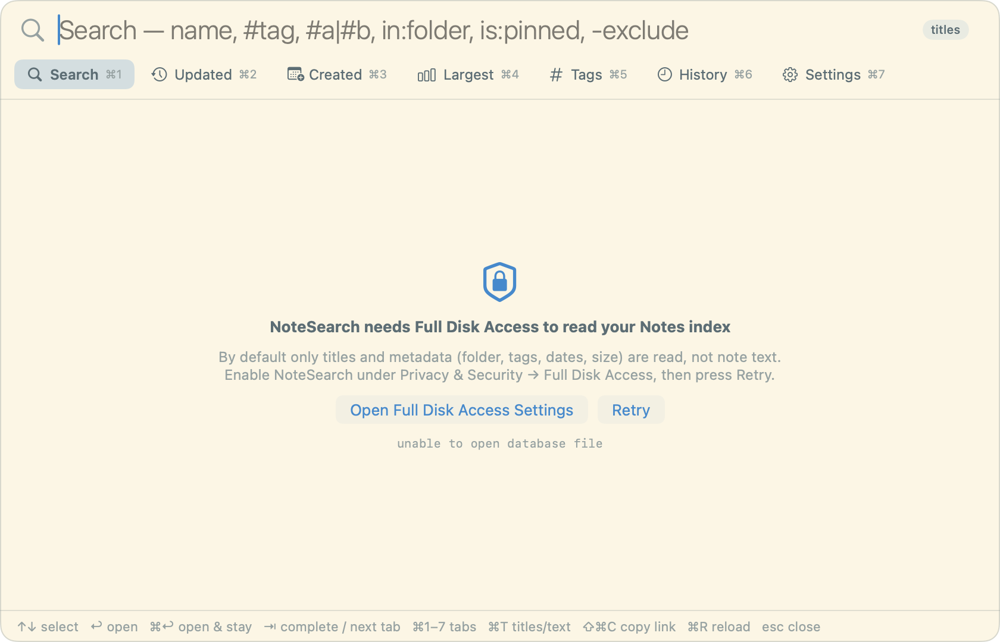
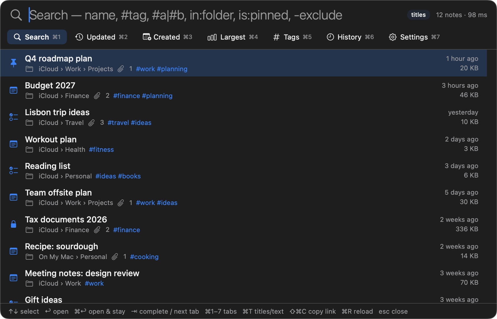

# Getting started

## Requirements

- macOS 14 (Sonoma) or later
- The built-in Apple Notes app, with at least one note

## Install

1. Download `NoteSearch-<version>.dmg` from the [latest release](https://github.com/giridharmb/AppleNoteSearch-Docs/releases/latest).
2. Open the DMG and drag **NoteSearch** onto the **Applications** shortcut.
3. Open NoteSearch from Applications.

NoteSearch has no Dock icon. Look for the magnifying-glass icon in the menu bar at the top right of the screen.
The first time it starts, the search popup opens by itself.

## Grant Full Disk Access (required, one time)

Apple protects the Notes library, so macOS only lets NoteSearch read it after you allow it.
Until you do, the popup shows this message instead of your notes:

1. In the popup, click **Open Full Disk Access Settings**
   (or open **System Settings → Privacy & Security → Full Disk Access** yourself).
2. Turn on **NoteSearch** in the list. If it is not listed, click **+** and choose NoteSearch from Applications.
3. Go back to the popup and click **Retry**.

NoteSearch uses this access only to read your Notes library: titles and metadata by default, and note text only
if you turn that on. See [Privacy](privacy.md).

## Your first search

1. Press **⌃⌥N** (Control-Option-N) anywhere, or click the menu-bar icon.
2. Start typing part of a note's title. Results update as you type.
3. Use **↑ / ↓** to pick a note and press **Return**. Notes comes to the front with that note open.

With nothing typed, the list shows the notes you opened most recently through NoteSearch, followed by your most
recently updated notes.

## Each result shows

- The note title, with the letters that matched your search underlined
- An icon: lock (locked note), pin (pinned), checklist, or plain note
- The folder, and the account name if you use more than one account
- A paperclip with the number of attachments, if it has any *(1.1+)*
- The note's hashtags
- When it was last updated, and the size of its text

Note contents are never shown.

The top right of the popup shows how many notes are listed out of how many you have, for example
"42 of 3,050 notes", and how long loading took *(1.2+)*.

## Next steps

- [Search syntax](search-syntax.md) — hashtags, combining filters, folders
- [How it works](how-it-works.md) — what is searched and what is not
- [Keyboard shortcuts](keyboard-shortcuts.md)
- [Tabs and settings](tabs-and-settings.md) — change the shortcut, theme and more
