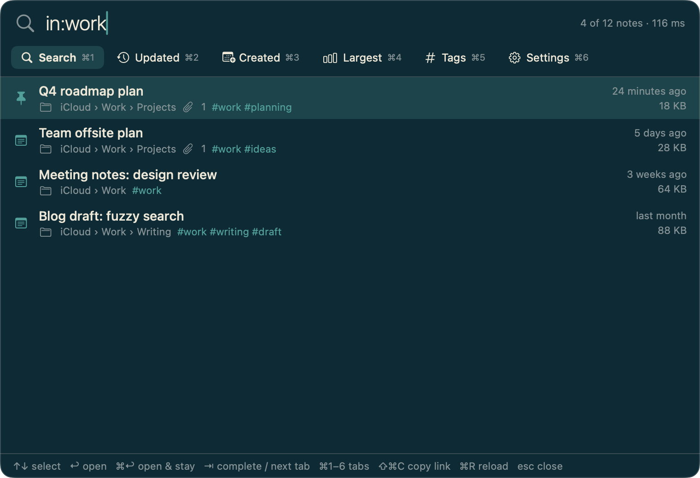
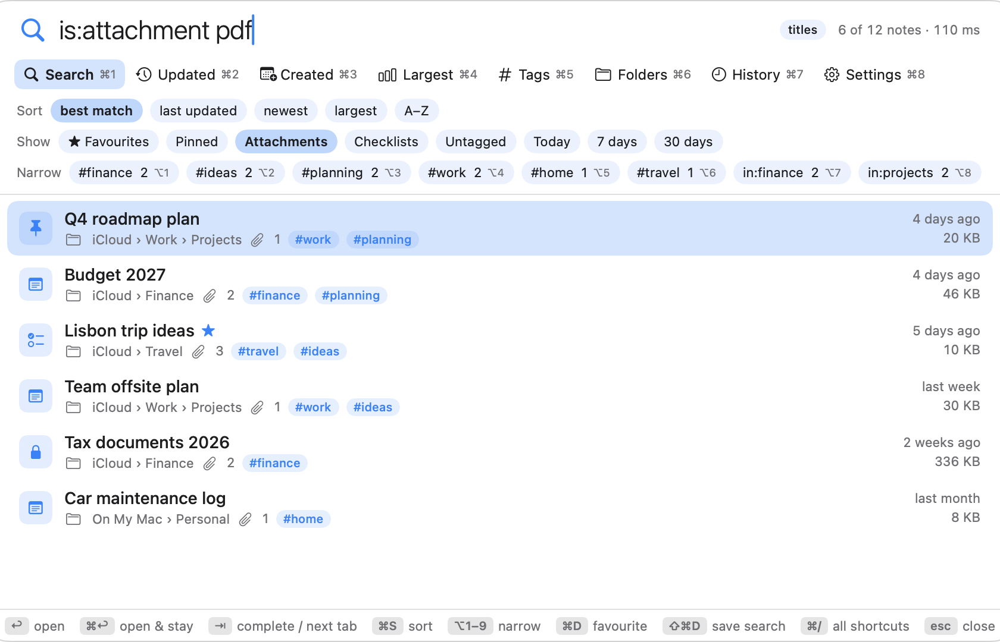
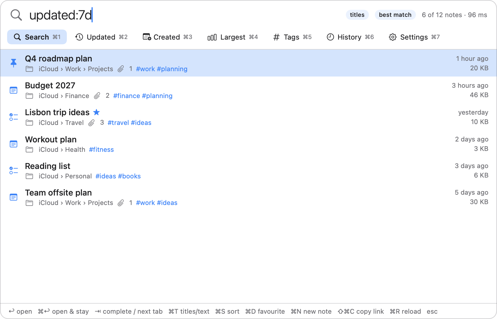
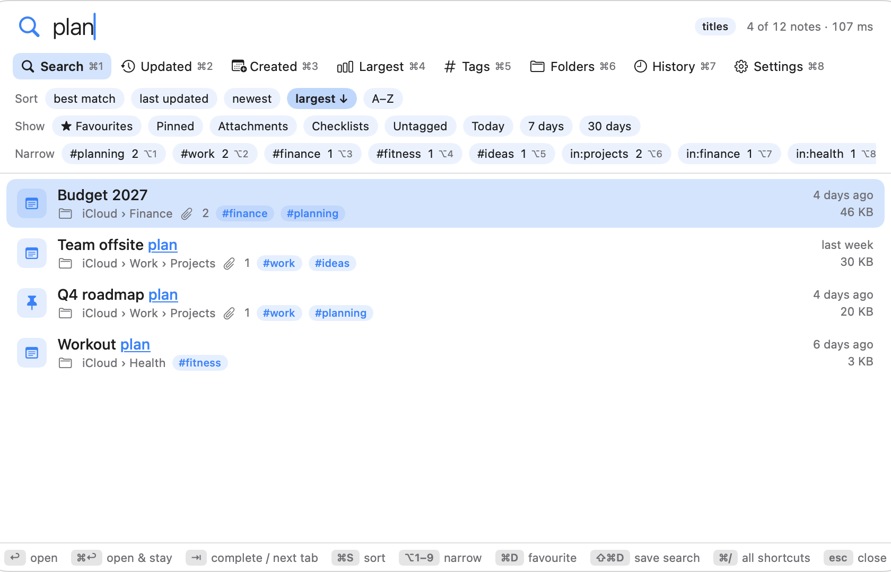
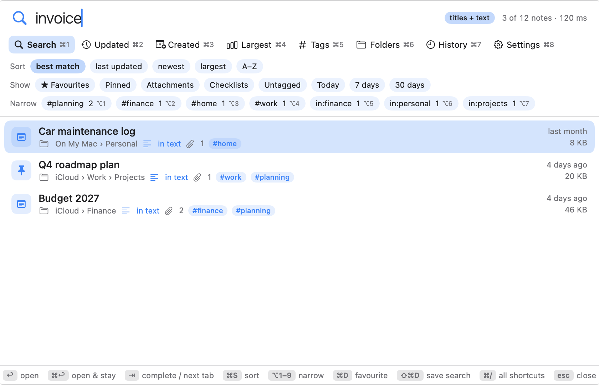
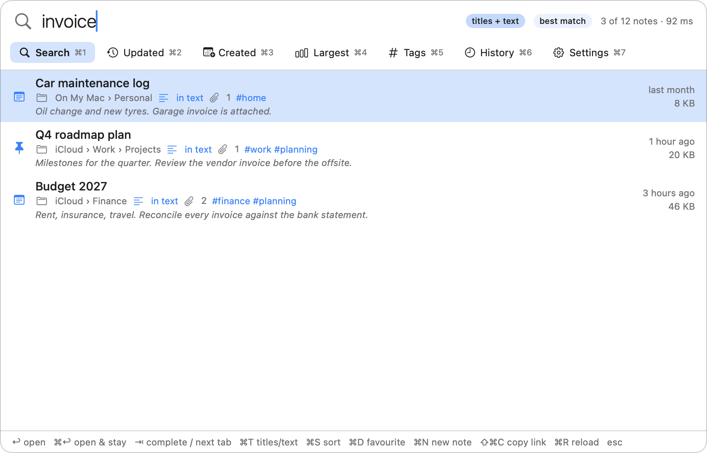
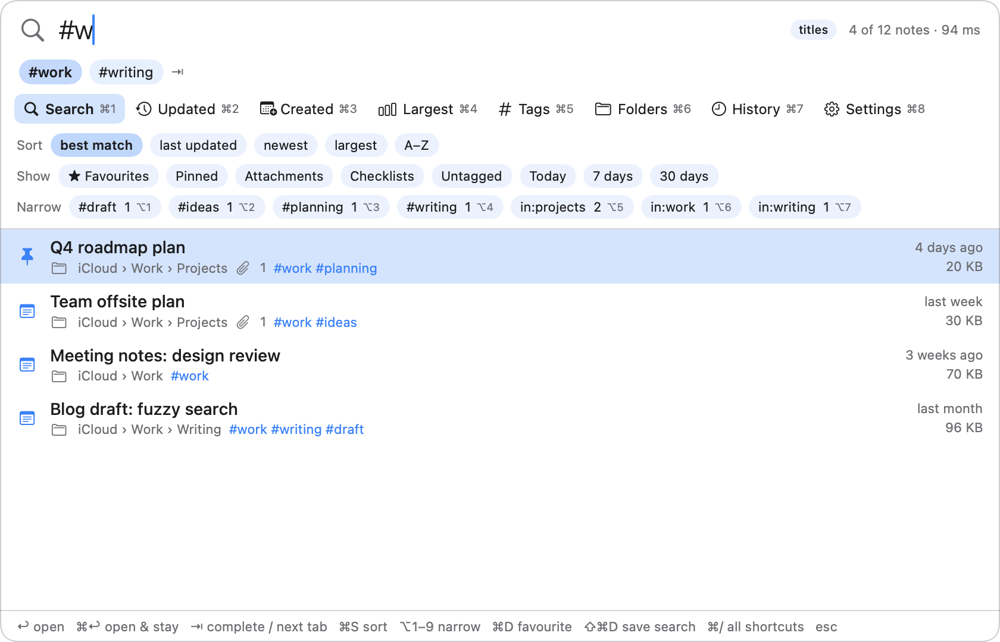

# Search syntax

Type one or more terms separated by spaces. A note must match **every** term. Upper/lower case and accents are
ignored, so `cafe` finds "Café".

## Terms

| Term | Matches | Example |
| --- | --- | --- |
| a word | Notes whose title, folder name, hashtags or attachment file names *(1.1+)* contain it | `budget` |
| `#tag` | Notes with that hashtag | `#work` |
| `in:name` | Notes in a folder whose name contains `name` (`folder:` also works) | `in:travel` |
| `account:name` | Notes in an account whose name contains `name` (`acct:` also works) | `account:icloud` |
| `is:pinned` | Pinned notes | |
| `is:locked` | Locked notes | |
| `is:checklist` | Notes that contain a checklist | |
| `is:attachment` | Notes that have at least one attachment (`has:attachment` also works) *(1.1+)* | |
| `is:favorite` | Notes you starred with **⌘D** (`is:fav` also works) *(1.4+)* | |
| `is:untagged` | Notes with no hashtags *(1.7+)* | |
| `is:shared` | Notes you share with other people, or that sit directly in a shared folder *(1.7+)* | |
| `size:` | Notes whose text is at least, or smaller than, a size. Units `k` and `m` *(1.7+)* | `size:>100k`, `size:<2m` |
| `updated:when` | Notes last changed in that period. See [Dates](#dates-14) *(1.4+)* | `updated:7d` |
| `created:when` | Notes created in that period *(1.4+)* | `created:2026-03` |
| `before:when` / `after:when` | Notes last changed before / after that period *(1.4+)* | `before:2026` |

Folder and account names are matched with spaces removed. For a folder called "Work Projects", type
`in:workprojects` or just `in:work`.

From version 1.1, nested folders are shown with their full path ("Work › Projects") and `in:` matches any part of
it, so `in:work` also finds notes in the sub-folders of "Work".

*`in:work` finds notes in "Work" and in "Work › Projects" and "Work › Writing".*

## Attachments

From version 1.1, a paperclip and a number show how many attachments a note has. `is:attachment` lists notes that
have any, and plain words also match attachment file names, so `is:attachment pdf` finds notes with a PDF attached.
Only file names are used, never what is inside the files.

## Dates *(1.4+)*

`updated:`, `created:`, `before:` and `after:` take a period written in one of these ways:

| You write | Period |
| --- | --- |
| `7d`, `2w`, `3m`, `1y` | The last 7 days, 2 weeks, 3 months, 1 year, up to now |
| `today`, `yesterday` | That day |
| `2026` | The whole year |
| `2026-03` | The whole month |
| `2026-03-15` | That day |

- `updated:7d` finds notes changed in the last week; `created:2026` finds notes created during 2026.
- `before:2026` finds notes last changed before 1 January 2026; `after:2026-03` finds notes changed after March 2026.
- Combine them like any other term: `#work updated:1m -is:locked`, or `updated:today|updated:yesterday`.

## Sort order *(1.4+)*

The Search tab normally lists the best match first. Press **⌘S**, or click the sort label at the top right, to
switch between **best match**, **last updated**, **newest** (most recently created) and **largest**. Your choice
is remembered.

*`plan`, sorted by largest.*

## Saved searches *(1.7+)*

Press **⇧⌘D** to save the search you are typing. Saved searches appear with a star at the top of the
[History tab](tabs-and-settings.md#history-13) and are never pushed out by newer searches. On the History tab,
**⌘D** saves or unsaves the highlighted entry and **Return** runs it.

## Hiding a folder or an account everywhere *(1.7+)*

In Settings, **Added to every search** takes ordinary search terms and applies them to every list. For example,
`-in:archive` hides everything in a folder called "Archive", and `-account:work` hides a whole account. Clear the
field to see everything again. Hashtag counts on the Tags tab are not affected.

## Favourites *(1.4+)*

Press **⌘D** on a note to star it; press again to remove the star. Starred notes show a star, are listed first
when the search box is empty, and are found by `is:favorite`.

## Searching inside note text *(1.3+)*

By default plain words match titles, folder names, hashtags and attachment file names. To also match the text
inside notes, turn on **Search inside note text** in Settings, press **⌘T**, or click the "titles" label at the
top right of the popup; it changes to "titles + text".

- A note found through its text is marked **in text** on its row. The text itself is not shown, unless you turn on
  **Show the matching line for text matches** in Settings *(1.4+)*, which adds the one line that matched.
- Title matches still rank above text matches.
- Text matching is exact (after ignoring case and accents). The fuzzy and typo fallbacks apply to titles only.
- Locked notes are never read, so their text cannot be searched.

*With "titles + text" on, `invoice` finds notes that mention an invoice even though their titles do not.*

*The same search with "Show the matching line" turned on.*

## Combining terms

| You type | Meaning |
| --- | --- |
| `#work #ideas` | Has **both** hashtags (AND) |
| `#work\|#ideas` | Has **either** hashtag (OR). `#work\|ideas` is a shorter way to write the same thing |
| `#work OR #ideas` | Also OR. `OR` must be in capitals |
| `-#draft` | Does **not** have the hashtag. A leading `-` excludes any kind of term |
| `#work plan` | Tagged `#work` and "plan" in the title |
| `#fitness\|#health in:personal -is:locked run` | Either hashtag, in a folder containing "personal", not locked, with "run" in the title |

OR also works for plain words and other terms, for example `invoice|receipt` or `in:work|in:clients`.

*`#work|#ideas plan`: tagged `#work` or `#ideas`, with "plan" in the title.*

## Hashtags

- While you are still typing a hashtag it matches as a prefix: `#wor` finds `#work` and `#workout`.
- Once what you typed is a complete hashtag that exists in your notes, it matches exactly: `#work` no longer
  finds `#workout`.
- Only real Notes hashtags are recognised (the ones Notes turns yellow when you type `#something` in a note).

## Autocomplete

- Type `#` to see hashtags that exist in your notes, most used first. Keep typing to narrow the list.
- Type `in:` to see your folders.
- Press **Tab** to accept the first (highlighted) suggestion, or click any suggestion.
- Autocomplete also works after `|`, so you can build `#work|#ideas` with two Tab presses.

*Typing `#w` suggests the hashtags that contain "w"; Tab accepts the highlighted one.*

## Fuzzy matching and typos

If a word is not found as typed, NoteSearch tries two looser matches against note titles:

- **Skipped letters** (3 letters or more): the letters must appear in order, close together.
  `wrkt` finds "Workout plan".
- **Typos** (5 letters or more): one wrong, missing, extra or swapped letter is allowed, two for words of
  9 letters or more. `wrokout` finds "Workout plan".

These looser matches always rank below exact matches. From version 1.1 they are tried only when nothing matches
exactly as typed, which keeps results clean and fast.

*`budgte` still finds "Budget 2027", and `in:fi` offers the Finance folder.*

## How results are ordered

On the **Search** tab, best matches come first:

1. Title is exactly what you typed
2. Title starts with it
3. A word in the title starts with it
4. It appears inside a word in the title
5. It matches the folder name
6. It matches the start of a hashtag
7. It matches an attachment file name *(1.1+)*
8. Fuzzy match
9. Typo match

Ties are ordered by most recently updated. The Search tab lists every match (versions before 1.2 stopped at 300).
When the list is only part of your library, the top right of the popup says so, for example "42 of 3,050 notes".

On the **Updated**, **Created** and **Largest** tabs the same search filters the list, but the order is fixed by
that tab. See [Tabs and settings](tabs-and-settings.md).
