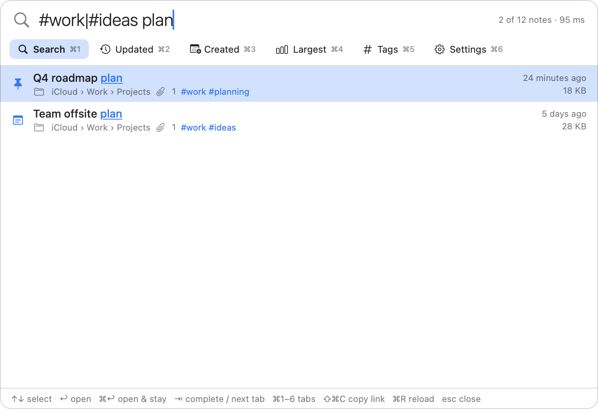
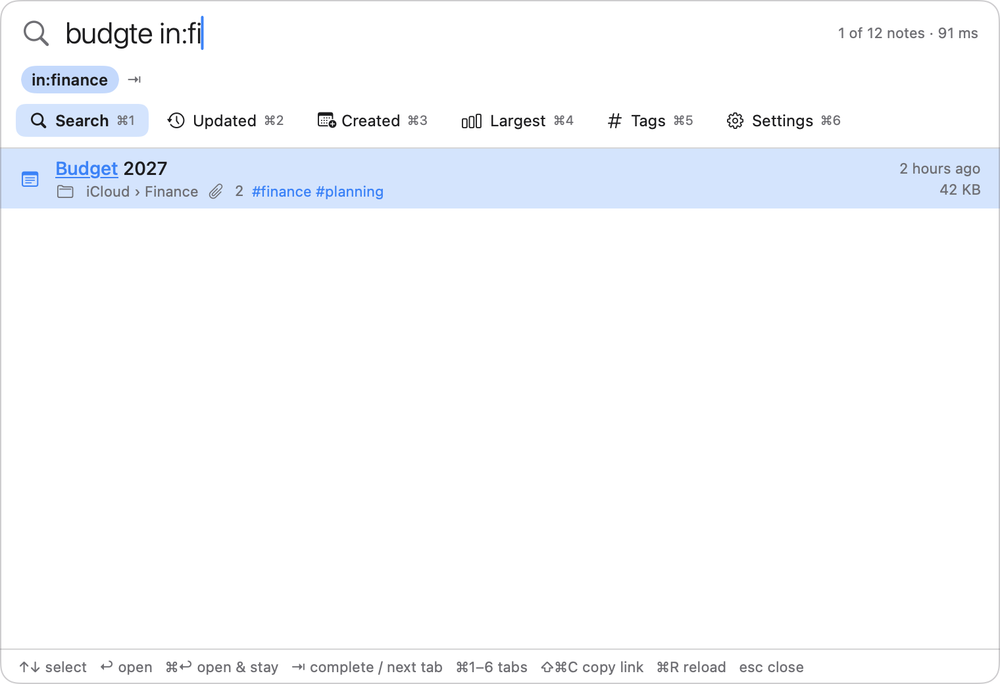

# Search syntax

Type one or more terms separated by spaces. A note must match **every** term. Upper/lower case and accents are
ignored, so `cafe` finds "Café".

## Terms

| Term | Matches | Example |
| --- | --- | --- |
| a word | Notes whose title, folder name, hashtags or attachment file names *(1.1+)* contain it | `budget` |
| `#tag` | Notes with that hashtag | `#work` |
| `in:name` | Notes in a folder whose name contains `name` (`folder:` also works) | `in:travel` |
| `account:name` | Notes in an account whose name contains `name` (`acct:` also works) | `account:icloud` |
| `is:pinned` | Pinned notes | |
| `is:locked` | Locked notes | |
| `is:checklist` | Notes that contain a checklist | |
| `is:attachment` | Notes that have at least one attachment (`has:attachment` also works) *(1.1+)* | |

Folder and account names are matched with spaces removed. For a folder called "Work Projects", type
`in:workprojects` or just `in:work`.

From version 1.1, nested folders are shown with their full path ("Work › Projects") and `in:` matches any part of
it, so `in:work` also finds notes in the sub-folders of "Work".

*`in:work` finds notes in "Work" and in "Work › Projects" and "Work › Writing".*

## Attachments

From version 1.1, a paperclip and a number show how many attachments a note has. `is:attachment` lists notes that
have any, and plain words also match attachment file names, so `is:attachment pdf` finds notes with a PDF attached.
Only file names are used, never what is inside the files.

## Combining terms

| You type | Meaning |
| --- | --- |
| `#work #ideas` | Has **both** hashtags (AND) |
| `#work\|#ideas` | Has **either** hashtag (OR). `#work\|ideas` is a shorter way to write the same thing |
| `#work OR #ideas` | Also OR. `OR` must be in capitals |
| `-#draft` | Does **not** have the hashtag. A leading `-` excludes any kind of term |
| `#work plan` | Tagged `#work` and "plan" in the title |
| `#fitness\|#health in:personal -is:locked run` | Either hashtag, in a folder containing "personal", not locked, with "run" in the title |

OR also works for plain words and other terms, for example `invoice|receipt` or `in:work|in:clients`.

*`#work|#ideas plan`: tagged `#work` or `#ideas`, with "plan" in the title.*

## Hashtags

- While you are still typing a hashtag it matches as a prefix: `#wor` finds `#work` and `#workout`.
- Once what you typed is a complete hashtag that exists in your notes, it matches exactly: `#work` no longer
  finds `#workout`.
- Only real Notes hashtags are recognised (the ones Notes turns yellow when you type `#something` in a note).

## Autocomplete

- Type `#` to see hashtags that exist in your notes, most used first. Keep typing to narrow the list.
- Type `in:` to see your folders.
- Press **Tab** to accept the first (highlighted) suggestion, or click any suggestion.
- Autocomplete also works after `|`, so you can build `#work|#ideas` with two Tab presses.

*Typing `#w` suggests the hashtags that contain "w"; Tab accepts the highlighted one.*

## Fuzzy matching and typos

If a word is not found as typed, NoteSearch tries two looser matches against note titles:

- **Skipped letters** (3 letters or more): the letters must appear in order, close together.
  `wrkt` finds "Workout plan".
- **Typos** (5 letters or more): one wrong, missing, extra or swapped letter is allowed, two for words of
  9 letters or more. `wrokout` finds "Workout plan".

These looser matches always rank below exact matches. From version 1.1 they are tried only when nothing matches
exactly as typed, which keeps results clean and fast.

*`budgte` still finds "Budget 2027", and `in:fi` offers the Finance folder.*

## How results are ordered

On the **Search** tab, best matches come first:

1. Title is exactly what you typed
2. Title starts with it
3. A word in the title starts with it
4. It appears inside a word in the title
5. It matches the folder name
6. It matches the start of a hashtag
7. It matches an attachment file name *(1.1+)*
8. Fuzzy match
9. Typo match

Ties are ordered by most recently updated. The Search tab lists every match (versions before 1.2 stopped at 300).
When the list is only part of your library, the top right of the popup says so, for example "42 of 3,050 notes".

On the **Updated**, **Created** and **Largest** tabs the same search filters the list, but the order is fixed by
that tab. See [Tabs and settings](tabs-and-settings.md).
