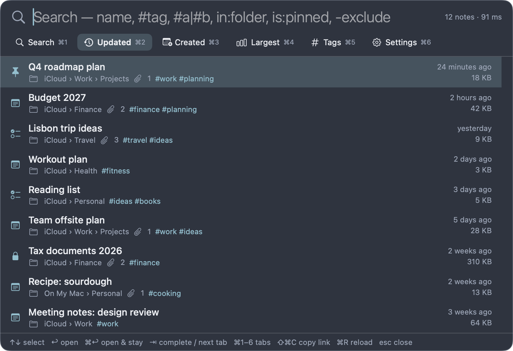
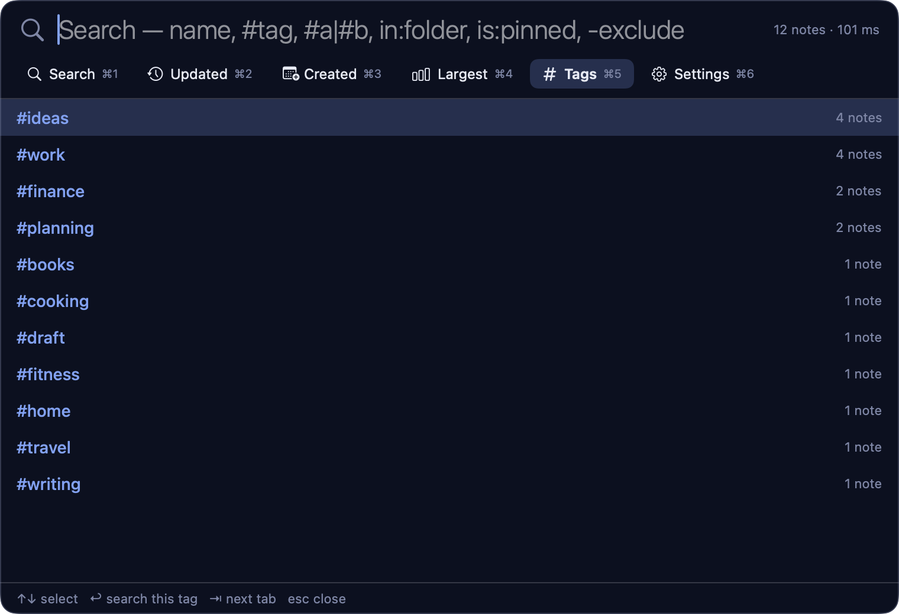

# Tabs and settings

## Tabs

Switch tabs with **⌘1 … ⌘6**, by clicking, or with **Tab** when no autocomplete suggestion is showing.

| Tab | Shows |
| --- | --- |
| **Search** (⌘1) | Everything that matches, best match first. Empty search: recently opened notes, then recently updated |
| **Updated** (⌘2) | The most recently updated notes |
| **Created** (⌘3) | The most recently created notes |
| **Largest** (⌘4) | The largest notes |
| **Tags** (⌘5) | Every hashtag with the number of notes that use it. Press Return on one to search for it |
| **Settings** (⌘6) | Options, below |

Updated, Created and Largest show the top 50 notes by default; you can change the number in Settings. Typing in
the search box filters these tabs too, using the full [search syntax](search-syntax.md). For example, on
**Largest**, `#work` shows your largest notes tagged `#work`.

*Updated tab, Nord theme.*

*Largest tab, Dracula theme.*

*Tags tab, Midnight theme.*

**About size:** the size shown is the stored size of the note's text. Photos, scans and other attachments are not
included, so a note with many images can still look small.

The popup always opens on the Search tab with an empty search box.

## Settings

| Setting | What it does | Default |
| --- | --- | --- |
| **Color theme** | System (follows light/dark mode), Light, Dark, Notes Yellow, Solarized Light, Midnight, Nord, Dracula, Solarized Dark | System |
| **Global shortcut** | Click **Record**, then press the combination you want. It must include Control, Option or Command. Esc cancels. **Disable** turns the shortcut off | ⌃⌥N |
| **Notes shown in Updated / Created / Largest** | How many notes those tabs list, from 5 to 500 | 50 |
| **Close popup after opening a note** | Off keeps the popup open after Return | On |
| **Hide popup when it loses focus** | Off keeps the popup visible when you click elsewhere | On |
| **Launch at login** | Start NoteSearch when you log in | Off |
| **Notes missing? → Copy diagnostics** | Copies a short report of counts about your Notes library to the clipboard, to paste into a bug report. It contains no note titles, folder names or account names *(1.2+)* | |

If another app already uses the shortcut you recorded, a red message appears under the setting. Record a
different one.
