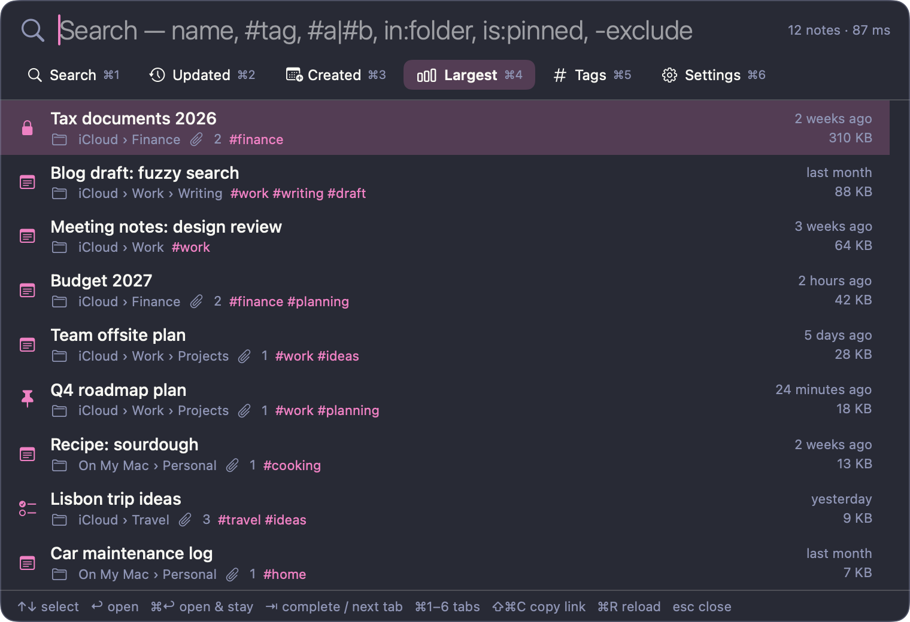
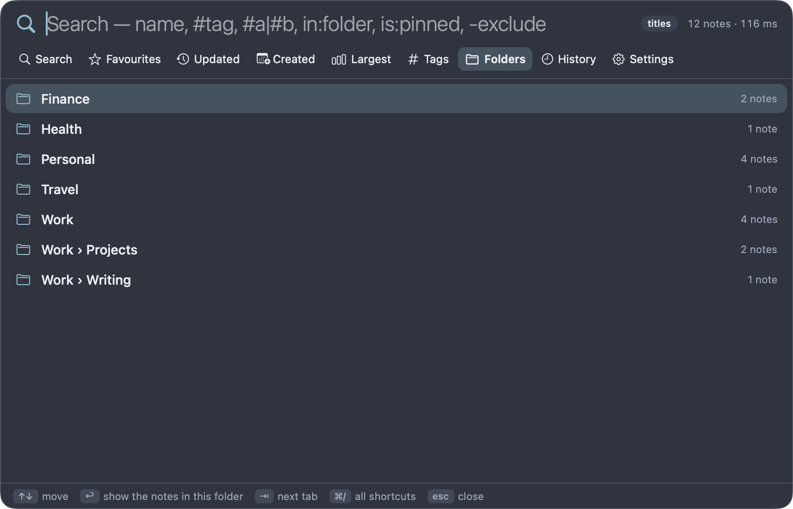
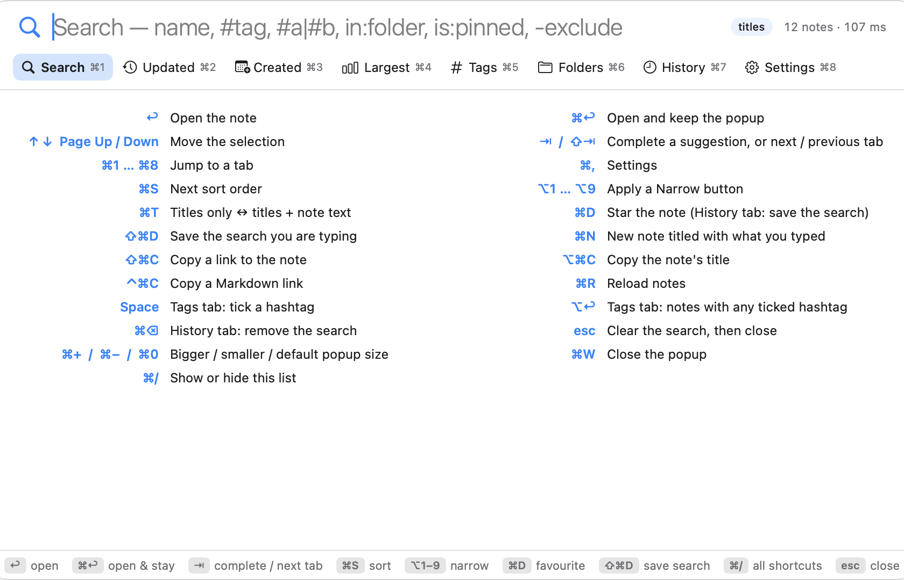
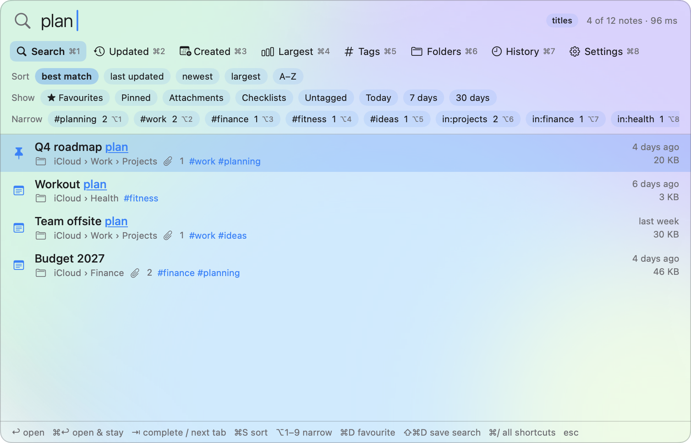
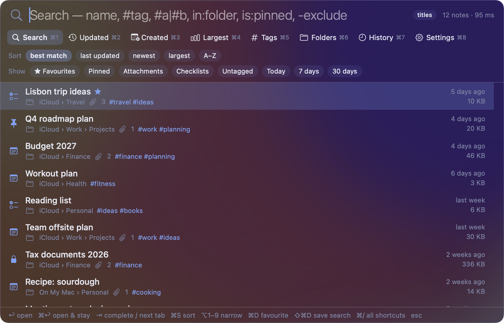

# Tabs and settings

## Tabs

Switch tabs with **⌘1 … ⌘9**, by clicking, or with **Tab** when no autocomplete suggestion is showing.

| Tab | Shows |
| --- | --- |
| **Search** (⌘1) | Everything that matches, best match first (⌘S changes the order). Empty search: favourites, then recently opened notes, then recently updated |
| **Favourites** (⌘2) | Notes you starred or gave a colour *(1.12+)* |
| **Updated** (⌘3) | The most recently updated notes |
| **Created** (⌘4) | The most recently created notes |
| **Largest** (⌘5) | The largest notes |
| **Tags** (⌘6) | Every hashtag with the number of notes that use it |
| **Folders** (⌘7) | Every folder with the number of notes in it *(1.8+)* |
| **History** (⌘8) | Your past searches *(1.3+)* |
| **Settings** (⌘9, or **⌘,**) | Options, below |

These numbers are for version 1.12. Earlier versions have fewer tabs, so the numbers after the missing tabs are
lower. From 1.12 the small ⌘-number hints on the tabs are shown only when the popup is wide enough.

The popup always opens on the Search tab with an empty search box.

### Favourites *(1.12+)*

Starred notes first, then notes with a colour, grouped in colour order. Type to filter the list. See
[Stars and colours](search-syntax.md#stars-and-colours) for how to mark notes.

### Updated, Created and Largest

These show the top 50 notes by default; you can change the number in Settings. Typing in the search box filters
these tabs too, using the full [search syntax](search-syntax.md). For example, on **Largest**, `#work` shows your
largest notes tagged `#work`.

*Updated tab, Nord theme.*

*Largest tab, Dracula theme.*

**About size:** the size shown is the stored size of the note's text. Photos, scans and other attachments are not
included, so a note with many images can still look small.

### Tags

Every hashtag in your notes, most used first, each with its note count. Type to filter the list. **⌘S** switches
between most used first and A–Z *(1.4+)*.

- **One hashtag:** highlight it and press **Return** to search for it.
- **Several hashtags** *(1.3+)*: press **Space** (or click) to tick each one. A bar appears showing how many notes
  have **all** of the ticked hashtags and how many have **any** of them. Press **Return** or click **All** to
  search for notes with all of them; press **⌥Return** or click **Any** for notes with any of them. **Clear**
  unticks everything.

*`#ideas` and `#work` ticked: 1 note has both, 7 notes have at least one.*

### Folders *(1.8+)*

Every folder, with nested folders shown as "Work › Projects", and the number of notes in it including its
sub-folders. Type to filter the list. Press **Return** to list that folder's notes on the Search tab.

### History *(1.3+)*

Your last 50 searches, newest first. A search is remembered when you open a note from it, or when you close the
popup with it still typed. Press **Return** to run one again, **⌘⌫** to remove it. Type to filter the list.
You can stop NoteSearch remembering searches, or clear them all, in Settings.

From version 1.7, **⌘D** saves the highlighted search (and **⇧⌘D** saves the one you are typing on the Search
tab). Saved searches show a star, stay at the top, and are kept when you clear the history. **⌘D** again unsaves
one.

## Settings

| Setting | What it does | Default |
| --- | --- | --- |
| **Color theme** | System (follows light/dark mode), Light, Dark, Notes Yellow, Solarized Light, Midnight, Nord, Dracula, Solarized Dark | System |
| **Wallpaper** | None, or one of six soft blurred backgrounds: Aurora, Sunset, Ocean, Forest, Lavender, Sand. See [Wallpapers](#wallpapers-19) *(1.9+)* | None |
| **Popup size** | **Smaller**, **Larger** and **Reset** change the popup's size. See [Popup size](#popup-size-17) *(1.9+)* | 840 × 540 |
| **Text size** | Small, Default, Large or Extra large, for the lists and tabs in the popup *(1.7+)* | Default |
| **Global shortcut** | Click **Record**, then press the combination you want. It must include Control, Option or Command. Esc cancels. **Disable** turns the shortcut off | ⌃⌥N |
| **Notes shown on the Search tab** | All, or the first 10, 25, 50, 100 or 250 matches. When the list is cut, the header says so, for example "first 25 of 140 matches" *(1.9+)* | All |
| **Notes shown in Updated / Created / Largest** | How many notes those tabs list, from 5 to 500 | 50 |
| **Search inside note text** | Also match plain words against the text of your notes. See [Privacy](privacy.md) *(1.3+)* | Off |
| **Show the matching line for text matches** | While searching inside note text, shows the one line that matched under each result *(1.4+)* | Off |
| **Added to every search** | Search terms applied to every list, for example `-in:archive` to hide a folder. See [Search syntax](search-syntax.md#hiding-a-folder-or-an-account-everywhere-17) *(1.7+)* | Empty |
| **Hide locked notes** | Keeps the titles of locked notes out of every list *(1.8+)* | Off |
| **Open the popup where I left it** | Off: the popup opens centred on the screen the pointer is on. On: it stays where you last dragged it *(1.8+)* | Off |
| **Close popup after opening a note** | Off keeps the popup open after Return | On |
| **Hide popup when it loses focus** | Off keeps the popup visible when you click elsewhere | On |
| **Launch at login** | Start NoteSearch when you log in | Off |
| **Check for updates once a day** | Asks GitHub for the latest version number and shows a notice when a newer one exists. Nothing about you or your notes is sent *(1.4+)* | On |
| **Remember searches in the History tab** | Off stops new searches being remembered *(1.3+)* | On |
| **Search history → Clear history** | Forgets all remembered searches *(1.3+)* | |
| **Hidden notes → Show / Unhide all** | Lists the notes you hid from NoteSearch, or brings them all back *(1.13+)* | |
| **Notes missing? → Copy diagnostics** | Copies a short report of counts about your Notes library to the clipboard, to paste into a bug report. It contains no note titles, folder names or account names *(1.2+)* | |

**All shortcuts** *(1.8+)*: press **⌘/** in the popup for a list of every key.

### Popup size *(1.7+)*

Drag any edge of the popup to resize it. From version 1.9 you can also press **⌘+** and **⌘−**, or use
**Smaller** / **Larger** in Settings; **⌘0** or **Reset** returns to the default size. After a resize the popup
moves back to the centre of the screen (unless **Open the popup where I left it** is on), and it opens at the
size you chose next time. It cannot be made larger than the screen or smaller than 640 × 360.

### Wallpapers *(1.9+)*

Choose a **Wallpaper** in Settings to give the popup a soft, blurred colour background. None is selected by
default. The wallpapers are drawn by NoteSearch itself: nothing is downloaded. Your colour theme is laid over the
wallpaper, so text stays readable in every light and dark theme.

*Aurora with the Light theme.*

*Sunset with the Midnight theme.*

**Updating** *(1.7+)*: when a newer version exists, a notice appears above the results. **Download and open** saves
the new disk image to your Downloads folder and opens it; drag NoteSearch to Applications as usual.

**VoiceOver** *(1.7+)*: results, tabs and the buttons at the top of the popup have spoken labels.

If another app already uses the shortcut you recorded, a red message appears under the setting. Record a
different one.
