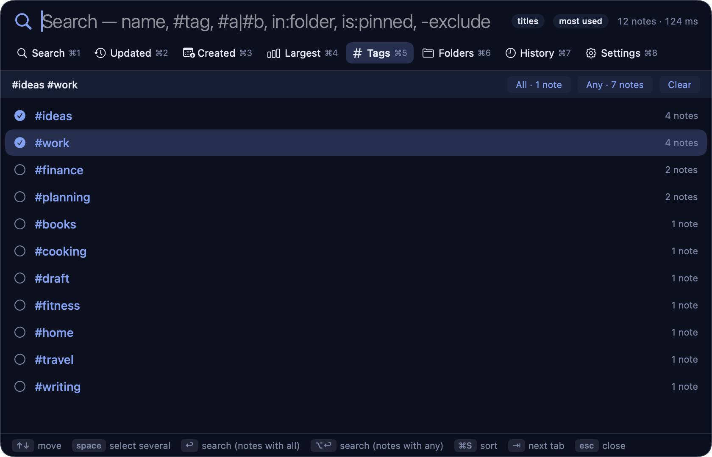
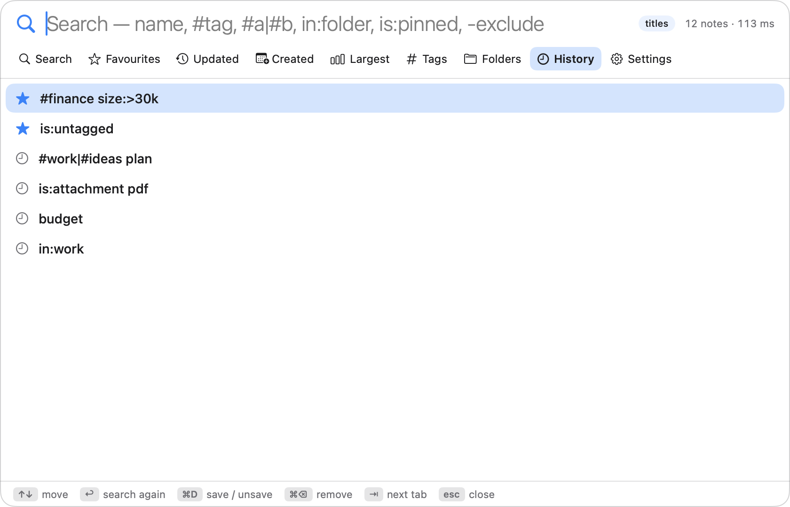
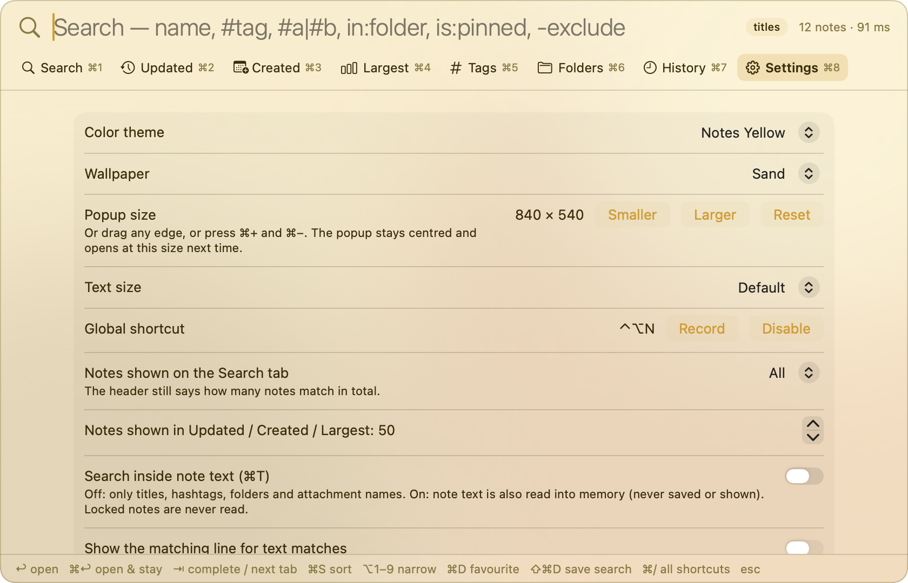

# Tabs and settings

## Tabs

Switch tabs with **⌘1 … ⌘7**, by clicking, or with **Tab** when no autocomplete suggestion is showing.

| Tab | Shows |
| --- | --- |
| **Search** (⌘1) | Everything that matches, best match first (⌘S changes the order). Empty search: favourites, then recently opened notes, then recently updated |
| **Updated** (⌘2) | The most recently updated notes |
| **Created** (⌘3) | The most recently created notes |
| **Largest** (⌘4) | The largest notes |
| **Tags** (⌘5) | Every hashtag with the number of notes that use it |
| **History** (⌘6) | Your past searches *(1.3+)* |
| **Settings** (⌘7) | Options, below *(⌘6 before 1.3)* |

The popup always opens on the Search tab with an empty search box.

### Updated, Created and Largest

These show the top 50 notes by default; you can change the number in Settings. Typing in the search box filters
these tabs too, using the full [search syntax](search-syntax.md). For example, on **Largest**, `#work` shows your
largest notes tagged `#work`.

*Updated tab, Nord theme.*

*Largest tab, Dracula theme.*

**About size:** the size shown is the stored size of the note's text. Photos, scans and other attachments are not
included, so a note with many images can still look small.

### Tags

Every hashtag in your notes, most used first, each with its note count. Type to filter the list. **⌘S** switches
between most used first and A–Z *(1.4+)*.

- **One hashtag:** highlight it and press **Return** to search for it.
- **Several hashtags** *(1.3+)*: press **Space** (or click) to tick each one. A bar appears showing how many notes
  have **all** of the ticked hashtags and how many have **any** of them. Press **Return** or click **All** to
  search for notes with all of them; press **⌥Return** or click **Any** for notes with any of them. **Clear**
  unticks everything.

*`#ideas` and `#work` ticked: 1 note has both, 7 notes have at least one.*

### History *(1.3+)*

Your last 50 searches, newest first. A search is remembered when you open a note from it, or when you close the
popup with it still typed. Press **Return** to run one again, **⌘⌫** to remove it. Type to filter the list.
You can stop NoteSearch remembering searches, or clear them all, in Settings.

## Settings

| Setting | What it does | Default |
| --- | --- | --- |
| **Color theme** | System (follows light/dark mode), Light, Dark, Notes Yellow, Solarized Light, Midnight, Nord, Dracula, Solarized Dark | System |
| **Global shortcut** | Click **Record**, then press the combination you want. It must include Control, Option or Command. Esc cancels. **Disable** turns the shortcut off | ⌃⌥N |
| **Notes shown in Updated / Created / Largest** | How many notes those tabs list, from 5 to 500 | 50 |
| **Search inside note text** | Also match plain words against the text of your notes. See [Privacy](privacy.md) *(1.3+)* | Off |
| **Show the matching line for text matches** | While searching inside note text, shows the one line that matched under each result *(1.4+)* | Off |
| **Close popup after opening a note** | Off keeps the popup open after Return | On |
| **Hide popup when it loses focus** | Off keeps the popup visible when you click elsewhere | On |
| **Launch at login** | Start NoteSearch when you log in | Off |
| **Check for updates once a day** | Asks GitHub for the latest version number and shows a notice when a newer one exists. Nothing about you or your notes is sent *(1.4+)* | On |
| **Save an index for the iPhone and iPad app** | Saves a list of your note titles, folders, hashtags, dates and attachment names (never note text) to **iCloud Drive › NoteSearch**. See [Privacy](privacy.md#index-file-for-iphone-and-ipad-15) *(1.5+)* | Off |
| **Remember searches in the History tab** | Off stops new searches being remembered *(1.3+)* | On |
| **Search history → Clear history** | Forgets all remembered searches *(1.3+)* | |
| **Notes missing? → Copy diagnostics** | Copies a short report of counts about your Notes library to the clipboard, to paste into a bug report. It contains no note titles, folder names or account names *(1.2+)* | |

If another app already uses the shortcut you recorded, a red message appears under the setting. Record a
different one.
